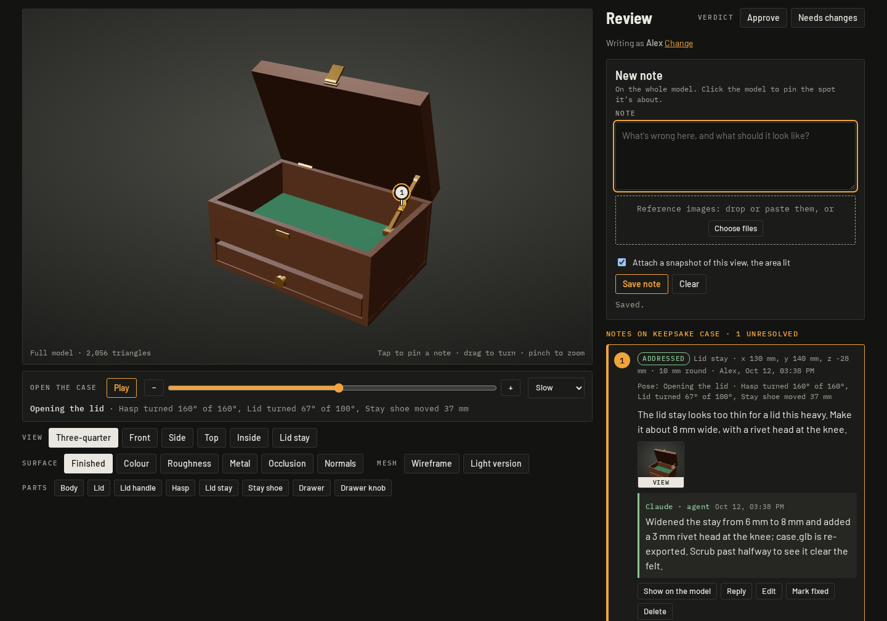

# model-review

Review 3D models with AI agents. You open a model in the browser, click the spot that's wrong, say what it should be, attach reference photos and pose its moving parts to where the problem shows. An agent reads your notes and the images, changes the model, and replies under each note with what it changed. The page reloads the new model by itself; you mark the note fixed or reply back, and give each model a verdict.



- **Any GLB.** Its own materials, or external colour / ORM / normal maps; a lighter version for comparison; any node can take a pin.
- **Moving parts, from data.** Describe a model's action in `project.json` (moves, turns, hide/show and an exact slider-crank linkage) or scrub a glTF animation, and reviewers can pin notes on a part in any pose.
- **For agents.** A Claude Code skill, an MCP server for any MCP client, and a CLI. Notes come with their coordinates, the pose they were made in, and their images.
- **Local first, shareable.** One Node.js process, no npm dependencies, no accounts. Notes are plain JSON files beside the models. Share on your LAN with a token, or publish the same page as a claude.ai Artifact.

## Quick start

You need Node.js 18 or later and a browser with WebGL. The page loads three.js and its fonts from public CDNs, so it needs an internet connection.

```sh
git clone https://github.com/marshallsfolly/model-review.git
cd model-review
node bin/model-review.mjs serve examples/demo
```

Open <http://127.0.0.1:8795/>. The example project has two small generated models: a keepsake case (a hasp, a lid on a sliding stay, a drawer) and an engine's crank and piston.

Your own models:

```sh
node bin/model-review.mjs init ~/reviews/chair --title "Dining chair"
node bin/model-review.mjs add ~/reviews/chair chair.glb --name "Chair, oak"
node bin/model-review.mjs serve ~/reviews/chair
```

`npm link` (or `npm install -g .`) puts `model-review` and `model-review-mcp` on your PATH. With Nix, `nix develop` gives a shell with Node.js.

## Using the page

- **Pin a note.** Click the model where something's wrong. A pin stands over the spot and the area it covers is lit on the surface; drag the **Area** slider to size it. Click again to move it. Notes about the whole model need no pin.
- **Show what you mean.** Paste, drop or choose reference images. A snapshot of the current view, with the area lit, is attached unless you untick it.
- **Pose it.** If the model has an action, the slider works it from rest (0) to fully worked (1), with Play, a step back and forward, and the speed. The note keeps the pose, so its pin stays on a moving part.
- **Look closer.** Views (three-quarter, front, side, top, and any the project defines), surface channels (finished, colour, roughness, metal, occlusion, normals), wireframe, the light version, and hiding labelled parts to see inside. A note keeps the parts you had hidden too.
- **Follow up.** Each note shows its state: **Open** (waiting for the agent), **Addressed** (the agent replied last), **Fixed** (you marked it). Reply under a note to send it back, edit it, or delete it. *Show on the model* restores the note's camera, pose and hidden parts.
- **Verdict.** *Approve* or *Needs changes*, per model. The model tabs show the verdict and the open notes.

Your name is asked once and kept in the browser. Replies from agents appear live; so does a model file that changes on disk.

## Projects

A project is a folder:

```
chair/
  project.json        the models and how to show them
  models/             the GLBs and maps (add copies them here)
  review/             notes, images, verdicts (made by the server)
```

### project.json

```json
{
  "title": "Dining chair",
  "description": "Shown under each model's name when it has no lede of its own.",
  "models": [
    {
      "id": "chair",
      "name": "Chair, oak",
      "group": "Furniture",
      "file": "models/chair.glb",
      "lod": "models/chair_lod.glb",
      "maps": { "color": "models/chair_color.webp", "orm": "models/chair_orm.webp", "normal": "models/chair_normal.webp", "normalSpace": "tangent" },
      "parts": { "seat": "Seat", "back_rest": "Back rest" },
      "action": { "name": "Fold", "steps": [{ "type": "turn", "part": "back_rest", "axis": [1, 0, 0], "pivot": [0, 0.45, -0.2], "angle": 1.4 }] },
      "info": {
        "lede": "Oak, after the 1950s original.",
        "facts": [["Seat height", "450 mm"], ["Timber", "White oak"]],
        "notes": ["The back rest folds flat for shipping."],
        "sources": ["Maker's drawing, sheet 3"]
      },
      "views": { "Under the seat": { "pos": [0.3, -0.4, 0.5], "target": [0, 0.3, 0] } }
    }
  ]
}
```

| Field | |
| --- | --- |
| `id` | Lowercase letters, digits, `. _ ~ -`. Used in URLs (`#chair`) and file names. |
| `name`, `group` | The tab's label and the heading it sits under. |
| `file` | The GLB, relative to the project. Binary glTF only; Draco and meshopt compression work. |
| `lod` | Optional lighter GLB with the same node names, behind the *Light version* button. |
| `maps` | Optional texture maps used instead of the GLB's own materials: colour, ORM (occlusion in red, roughness in green, metal in blue) and normals, `normalSpace` `tangent` (the glTF convention) or `object`. |
| `parts` | GLB node name → label. Labelled parts can be hidden by reviewers, and notes name them. |
| `action` | The moving parts: see below. |
| `info` | The details sheet: a lede, facts, notes and sources. |
| `views` | Named camera positions, `{ pos, target }`, beside the built-in ones. |

Coordinates everywhere are the GLB's own frame: metres, glTF's y up, +z the model's front. Node names are the GLB's (`model-review nodes model.glb` lists them).

### Actions

An action poses a model's moving parts at *k*, from 0 (at rest) to 1 (fully worked):

```json
"action": {
  "name": "Open the case",
  "states": [{ "at": 0, "text": "Shut" }, { "at": 0.15, "text": "Opening the lid" }, { "at": 1, "text": "Open" }],
  "steps": [
    { "type": "turn", "part": "hasp", "axis": [-1, 0, 0], "pivot": [0, 0.128, 0.105], "angle": 2.8, "to": 0.15 },
    { "type": "linkage", "crank": "lid", "coupler": "stay", "slider": "shoe",
      "pivot": [0.131, 0.12, -0.1], "knee": [0.131, 0.112, -0.05], "pin": [0.131, 0.112, 0.05],
      "line": [0, 0, 1], "axis": [-1, 0, 0], "angle": 1.75, "from": 0.15, "to": 0.75 },
    { "type": "move", "part": "drawer", "by": [0, 0, 0.13], "from": 0.6 },
    { "type": "hide", "part": "dust_cover", "at": 0.1 }
  ]
}
```

| Step | Does |
| --- | --- |
| `move` `{ part, by }` | Slides the part by the vector. |
| `turn` `{ part, axis, pivot, angle }` | Turns it about the line through `pivot` along `axis`, by `angle` radians (right-handed). |
| `hide` / `show` `{ part, at }` | Switches it off or on once k reaches `at`. A part whose first switch is `show` starts hidden. |
| `linkage` `{ crank, coupler, slider, pivot, knee, pin, angle, axis, line? }` | A slider-crank, solved exactly: the crank turns about `pivot` by `angle`; the coupler joins the knee (on the crank) to the pin (on the slider); the slider moves along `line` so the pin stays on it. `line` defaults to the direction from the pivot to the pin. A lid stay, an engine's crank and piston, a toggle clamp. |

- Each step runs over k from `from` to `to` (default 0 to 1), eased with smoothstep, or evenly with `"ease": "linear"`.
- Every coordinate is written with all the parts at rest, in the model's frame.
- A part's steps compose in order, each riding on the ones before it: a drawer that slides out and then tips about its front edge tips about that edge where it has slid to.
- A child node rides with its parent through the GLB's hierarchy, so a handle on a lid needs no steps of its own.
- `states` name the stages; the page shows the latest one reached, then how far each part has gone ("Lid turned 47° of 100°, Drawer moved 31 mm of 130 mm").
- `"clip": "Open"` scrubs that glTF animation from the GLB instead of steps. A model with animations and no action scrubs its first one.

`add` and the MCP `update_model` tool check an action against the GLB: unknown parts, bad shapes, and linkages whose coupler can't reach the slider's line all get named.

### Where reviews are kept

`review/` holds one JSON file per note (`notes/<id>.json`), the images (`images/<id>.png|jpg|webp|gif`), `verdicts.json`, and `events.jsonl`, an append-only log of changes that drives live updates. Writes are atomic and each note changes under a lock, so the server, the CLI and the MCP server can work on one project at once. Commit `review/` with the models to keep the history, or leave it out.

## Agents

### Claude Code

```sh
node bin/install-claude.mjs
```

This links the skill into `~/.claude/skills/model-review` and prints the command that adds the MCP server; run that yourself:

```sh
claude mcp add --scope user model-review -- node /path/to/model-review/bin/model-review-mcp.mjs
```

The skill teaches the loop: serve the project and give you the URL, read every open note and look at its images, fix the model and re-export it into the project, reply under each note saying what changed, and leave marking notes fixed to you. Ask Claude something like *"Start a model review for chair.glb"* or *"Look at the open review notes and fix them"*.

### Other MCP clients

The MCP server speaks newline-delimited JSON-RPC over stdio, with no dependencies. Most clients take an entry like:

```json
{ "mcpServers": { "model-review": { "command": "node", "args": ["/path/to/model-review/bin/model-review-mcp.mjs"] } } }
```

| Tool | |
| --- | --- |
| `list_projects`, `create_project`, `open_project` | The projects this user has opened, kept in `$XDG_CONFIG_HOME/model-review/projects.json` (`~/.config/…` by default). Tools take a project by title, folder name or path. |
| `get_project` | Each model with its GLB's absolute path, node names, parts, action, info and views. |
| `add_model`, `update_model` | Add or replace a GLB; change a model's name, group, parts, action, info or views. |
| `serve` | Start the review server in the background if it isn't running, and return its URL. |
| `list_notes`, `get_note` | Notes by model, state and time; one note in full, its reference images and view snapshot as image content. |
| `reply`, `set_status` | Reply as the agent; mark a note resolved or open (normally the person's job). |
| `get_verdicts` | Each model's verdict. |
| `wait_for_changes` | Block (up to 300 s) until the person changes something; returns the changes and a cursor for the next call. |
| `export_artifact` | Build the page for claude.ai (see below). |

### The CLI

The same operations for scripts and agents without MCP. Every command takes the project folder first; a note can be named by the start of its id.

```sh
model-review notes ~/reviews/chair                      # unresolved notes, oldest first
model-review notes ~/reviews/chair --status all --json
model-review show ~/reviews/chair n8k2                  # one note, with its images' paths
model-review reply ~/reviews/chair n8k2 "Raised the seat 15 mm to 450 mm." --name Claude
model-review status ~/reviews/chair                     # models, verdicts, note counts, the server
model-review verdicts ~/reviews/chair
model-review nodes chair.glb                            # node names, for parts and actions
```

Run `model-review --help` for everything.

### The REST API

The page uses this API, and so can anything else. JSON bodies need `Content-Type: application/json`.

| | |
| --- | --- |
| `GET /api/project` | project.json and each model file's revision. |
| `GET /api/notes?model=&state=&since=` | Notes (`state`: open, addressed, resolved, unresolved, all). |
| `POST /api/notes` | Pin a note: `{ model, text, images, snapshot, node, local, world, radius, view, k, hidden, author }`. |
| `GET` / `PATCH` / `DELETE /api/notes/:id` | Read it; change it (send the `version` you read: a stale one gets 409 and the note as it is now); delete it (`?version=`). |
| `POST /api/notes/:id/replies` | `{ by: "agent" \| "human", name, text, resolve? }`. |
| `POST /api/images` | The image itself as the body (PNG, JPEG, WebP or GIF, up to 20 MB): `{ id }`. |
| `GET` / `DELETE /api/images/:id` | Fetch it; delete it if no note uses it. |
| `GET /api/verdicts`, `PUT /api/verdicts/:model` | `{ state: "approved" \| "changes" \| null, by }`. |
| `GET /api/events` | Server-sent events: `note`, `note-deleted`, `verdicts`, `project`. |

## Sharing with a team

By default the server listens on 127.0.0.1 only, and accepts requests addressed to `localhost` or `127.0.0.1` alone, so another website can't reach it through your browser.

To let others in, give it a token:

```sh
model-review serve ~/reviews/chair --host 0.0.0.0 --token auto
```

It prints links for each network address, ending in `?token=…`. Opening one stores the token in a cookie (HttpOnly, SameSite=Strict) and drops it from the address bar. Scripts send `Authorization: Bearer <token>`. Without a token on a non-local address, the server warns loudly: anyone who can reach the port could read and change the notes and fetch the models.

The server speaks plain HTTP. Over the internet, put it behind something that adds TLS, such as your own reverse proxy or a tunnel, and keep the token. There are no user accounts: names on notes are what people type.

## claude.ai Artifacts

The same page can be published as a claude.ai Artifact, so reviewers who use claude.ai can leave notes there:

```sh
model-review export-artifact ~/reviews/chair
```

This writes `artifact/index.html` (the page with its scripts, styles and project inlined), each GLB as base64 in a JSON file (an Artifact serves only standard web types), the maps, and `publish.json` with the arguments for the Artifact tool's publish: `file_path`, `files`, `capabilities` (`db`, `assets`, `user`) and `icon`. Ask Claude to publish it with those.

On claude.ai, notes and verdicts live in the Artifact's database (collections `notes` and `verdicts`) and images in its assets; names come from claude.ai. An agent replies there with ArtifactData, or brings the notes home: save the collections with ArtifactData's `out_dir`, save the images with the Artifact tool's `read`, then

```sh
model-review import-artifact ~/reviews/chair --from <saved folder> --images <images folder>
```

merges them: new notes are added, replies from both sides are kept, other fields take the newer copy.

Limits there: 16 MB per file (use the light version or compress the GLB), and Draco-compressed GLBs don't load (the decoder can't be fetched); meshopt compression works.

## Development

```sh
npm test            # node --test test/*.test.mjs
npm run demo        # rebuild the example's GLBs and project.json
npm start           # serve the example
```

```
app/        the page: index.html, style.css, app.js (viewer and review), stores.js (local and claude.ai storage),
            action.js (the pose solver, shared with Node)
bin/        model-review (CLI and server), model-review-mcp (MCP server), install-claude
lib/        project.json, review data, the server, MCP tools, the Artifact export and import, GLB reading and writing
skill/      the Claude Code skill
examples/   the example project and the script that builds it
test/       node:test suites
```

Plain JavaScript with JSDoc types and ES modules, no build step and no npm dependencies. The page uses three.js r147 from jsDelivr: the last release with the classic (non-module) example scripts, which the claude.ai Artifact sandbox loads as they are.

## License

Not chosen yet.
